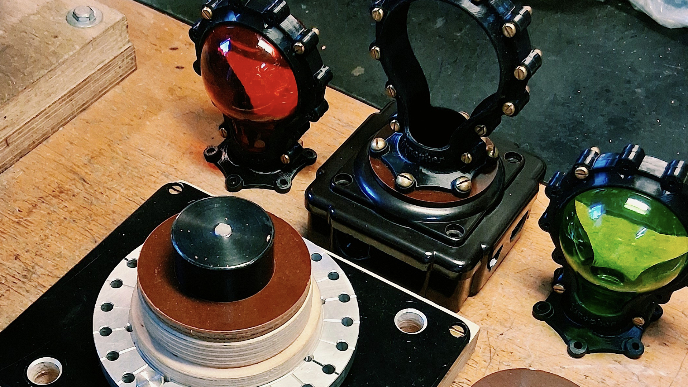

Maker Media GmbH

***

# Selbstgebaute Werkzeuge

**Wer kreativ mit recyceltem Material arbeitet und an die Grenzen gängiger Werkzeuge stößt, braucht eigene Lösungen. Diese können besonders wiederkehrende Aufgaben vereinfachen und sorgen gleichzeitig für einheitliche Ergebnisse.**

Hier findet ihr die 3D-Druckdaten für den Edison-Rahmen aus dem Artikel.

Der vollständige Artikel zum Projekt steht in der **[Make-Ausgabe 6/26](https://www.heise.de/select/make/2026/6)**.
